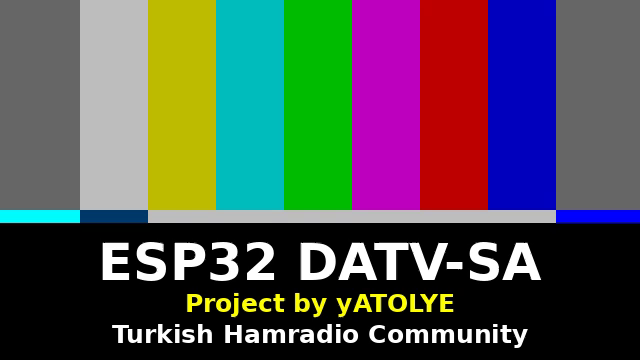

# ESP32-DATV-RX

A DVB-S2 receiver built around an **ESP32-S3**. It is the receiving half of
[ESP32-DATV-SA](https://github.com/barisdinc/ESP32-DATV-SA), the stand-alone ESP32-C3 DATV transmitter.

*Türkçe kılavuz aşağıda: [Türkçe](#türkçe).*

> **Status:** works at **125 kS/s** and, with the **wide mode** (`--wide`), at the transmitter's default **333 kS/s**.
> On the bench the ESP32-S3 received the ESP32-C3 beacon (DVB-S2 QPSK 3/4, pilots): 275 of 276 PLFRAMEs at
> 125 kS/s and 322 of 323 at 333 kS/s were decoded without errors, with no USB drops.



## How it works

The ESP32-S3 has an undocumented "radio dump" engine. It writes the Wi-Fi receiver's raw I/Q samples into
SRAM at 16 Msps. [eSpDR](https://github.com/h0m3us3r/eSpDR) by h0m3us3r found it, and
[esp32-sdr-trx](https://github.com/jochenhammes/esp32-sdr-trx) by Jochen Hammes turned it into a
one-board receiver. The chip decimates 16 Msps to 333 ksps of int8 I/Q and streams it over USB, and `espdr-rx`
serves it as an `rtl_tcp` server (1.84 to 2.79 GHz). For wider signals this project adds a **cs4** format to that
firmware: 500 ksps of packed 4-bit I/Q with a gain per packet and on-chip DC removal, 0.5 MB/s
([details](esp32-sdr-trx/README.ESP32-DATV-RX.md)). The ESP32 only moves samples; everything else runs on the PC:

```
ESP32-C3 (ESP32-DATV-SA) ~~ 13 cm DVB-S2 ~~> ESP32-S3: I/Q capture, decimation
                                                  │ USB: 333 ksps int8 (0.67 MB/s)  or  --wide: 500 ksps cs4 (0.5 MB/s)
                                                  ▼
            espdr-rx (rtl_tcp) / espdr.nb → rx_dvbs2.py → leandvb (DVB-S2, LDPC) → TS → ffmpeg → ffplay
```

## What you need

- **Receiver:** an ESP32-S3 board with **two USB ports** (a USB-UART bridge such as CH343/CP2102 plus the native
  USB port). Connect **both** to the PC. Tested: ESP32-S3-WROOM-1 (N16R8 class, chip v0.2). The PCB antenna is
  enough on the bench.
- **Transmitter:** an ESP32-C3 with [ESP32-DATV-SA](https://github.com/barisdinc/ESP32-DATV-SA), at its default
  **333 kS/s** (receive with `--wide`) or at **125 kS/s** (front panel, or `tx_dvbs.py` on the PC).
- **PC:** Linux (tested: Ubuntu, x86-64) with `python3 python3-venv git g++ make ffmpeg`:
  ```sh
  sudo apt install python3 python3-venv git g++ make ffmpeg
  ```

## Installation

Download `ESP32-DATV-RX-vX.Y.Z.zip` from [Releases](https://github.com/barisdinc/ESP32-DATV-RX/releases) and unpack
it, or clone this repository. Then, in its folder:

```sh
tools/install.sh
```

This creates `.venv/` with `espdr-rx` and `espdr.nb` from `firmware/*.whl` (it carries the receiver firmware) and builds `leandvb` into
`build/leansdr/`, which takes about a minute. Nothing is installed system-wide. Once, optionally, install the udev
rule that the script prints. It keeps ModemManager away from the board and lets you use it without the `dialout` group.

## Loading the receiver firmware into the ESP32-S3

The receiver firmware is `firmware/rx.bin`: esp32-sdr-trx 1.0.0-rc4 with the cs4 format added (source in
`esp32-sdr-trx/`, rebuild with `tools/build-firmware.sh`; the same image is inside the wheel). It does everything the
upstream image does, so `espdr-rx` and SDR++ work as before. There are two ways to run it.

**A. Into RAM, automatically (recommended).** You do nothing: `rx_dvbs2.py` starts `espdr-rx` (or, with `--wide`, loads
the firmware itself), which checks
the board and, if the receiver is not running, loads it through the USB-UART port into RAM (about 8 s). The flash
is **not touched**, so whatever the board ran before comes back after a power cycle, and the loading repeats after
every power-up. By hand:

```sh
.venv/bin/espdr-rx --decim 3          # loads when needed, then serves rtl_tcp on 127.0.0.1:1234
```

**B. Into flash, permanently.** The board then starts the receiver by itself at power-up. This **erases what is
in the flash**:

```sh
.venv/bin/espdr-rx --flash            # writes bootloader (0x0), partition table (0x8000), rx.bin (0x10000)
```

or with plain esptool and the files in `firmware/` (port = the USB-UART port, for example `/dev/ttyUSB0` or `/dev/ttyACM1`):

```sh
.venv/bin/python -m esptool --chip esp32s3 --port /dev/ttyUSB0 --baud 921600 write-flash \
    0x0 firmware/bootloader.bin 0x8000 firmware/partition-table.bin 0x10000 firmware/rx.bin
```

The bootloader is configured for quad (DIO) flash; boards with octal flash need method A. To go back to RAM-only,
run `.venv/bin/python -m esptool --chip esp32s3 erase-flash`.

> **Check the port before you flash.** If the transmitter (ESP32-C3) is also plugged in, `lsusb` and
> `ls /dev/ttyACM* /dev/ttyUSB*` tell you which port is which. The ESP32-S3 shows a USB-UART bridge (for example
> `1a86:55d3`) and, once the receiver runs, `303a:1001`. **Do not write the S3 image to the C3.**

## Receiving

```sh
./rx_dvbs2.py --wide --sr 333000 --freq 2300.5   # the transmitter's default: 333 kS/s
./rx_dvbs2.py --freq 2300.5                      # 125 kS/s (up to about 200 kS/s)
```

`rx_dvbs2.py` starts `espdr-rx` if it is not running (with `--wide` it reads the board through `espdr.nb` instead), looks
for the signal near `--freq`, tunes to its centre and opens an ffplay window with the picture. Every 5 s it prints the number of frames decoded with and
without errors. Ctrl-C or closing the window ends it.

| Option | Default | |
|---|---|---|
| `--freq MHz` | 2300.5 | the transmitter's frequency |
| `--wide` | | 500 ksps cs4: symbol rates up to about 333000 |
| `--sr S/s` | 125000 | symbol rate (without `--wide` about 200000 at most, see below) |
| `--cr`, `--const` | 3/4, QPSK | code rate and constellation |
| `--gain dB` | 10 | receiver gain, 0 to 49.6 dB |
| `--no-search` | | tune exactly to `--freq` |
| `--record FILE.ts` | | also save the transport stream |
| `--no-play`, `--stdout` | | no window; TS to stdout (for VLC, ffmpeg, ...) |
| `-v` | | show leandvb's messages |

Examples from the bench: `./rx_dvbs2.py --freq 2301.5` found the transmitter at 2301.385 MHz (−115 kHz, the
crystal errors of both boards together) and decoded 109 of 110 frames at 125 kS/s;
`./rx_dvbs2.py --wide --sr 333000 --freq 2301.5` decoded 322 of 323 frames at 333 kS/s (about 10 frames and 330 TS
packets per second).

### Tips

- **Gain:** with the antennas close together, 10 dB works. At the default 60 of espdr-rx the samples clip. If the
  level fades (people moving, multipath on the bench), raise the gain a little rather than lower it, because weak
  int8 samples lose resolution.
- **Frequency offset:** the search covers up to about ±200 kHz. Beyond that, give a closer `--freq` or use `--ppm`.
- **Margin at 333 kS/s:** the same power spreads over 2.7 times the bandwidth, so the signal stands only about 11 to
  14 dB above the floor where 125 kS/s showed 25 to 30 dB. leandvb's bit-flip LDPC needs about 12 to 14 dB, so keep
  the antennas close; the soft-decision decoder on the roadmap would gain about 9 dB.
- **`--wide` and espdr-rx:** both use the board's native port. Stop a running `espdr-rx` before `--wide`.
- **"X Error ... GLX" in ffplay:** `rx_dvbs2.py` sets `SDL_VIDEO_X11_FORCE_EGL=1`, which avoids it. Do the same
  when you start ffplay yourself.
- **The picture updates rarely:** the stand-alone transmitter loops a short test-card stream from RAM, and its TS
  timestamps jump back at every loop (they also run off real time at rates other than 333 kS/s).
  `rx_dvbs2.py` retimes the frames for ffplay.
- **Other programs:** while `espdr-rx --decim 3` runs, SDR++ or SDRangel (DATV demodulator) can use it as an
  RTL-TCP source at `127.0.0.1:1234`.

## The bandwidth problem

| Transmitter symbol rate | Occupied bandwidth (roll-off 0.35) | Fits the receiver? |
|---|---|---|
| 125 kS/s | ≈ 170 kHz | **yes**: 333 ksps, 2.7 samples per symbol |
| 250 kS/s | ≈ 340 kHz | no: the edges are cut |
| 333 kS/s (TX default), int8 | ≈ 450 kHz | no: 333 ksps int8 is limited to ±133 kHz, 500 ksps int8 needs 1.0 MB/s |
| **333 kS/s with `--wide` (cs4)** | ≈ 450 kHz | **yes**: 500 ksps × 1 byte = 0.5 MB/s, 1.5 samples per symbol, flat to ±200 kHz |
| 500 kS/s | ≈ 675 kHz | planned: a 667 ksps cs4 rate (0.67 MB/s) |

The limit is USB Full-Speed (0.87 MB/s measured by esp32-sdr-trx), not the CPU (the cs4 build uses at most 72 % of
its time budget at 500 ksps). `tools/sim_wide.py` tested the format offline before it was built: with the per-packet
gain, 4-bit quantisation costs about 0.07 dB at Es/N0 = 5 dB and 0.5 dB at 14 dB.

## Roadmap

1. ~~Proof of concept: esp32-sdr-trx + leandvb, transmitter at 125 kS/s.~~ Done.
2. ~~One-command receiver `rx_dvbs2.py`.~~ Done.
3. ~~**Wide mode** in the receiver firmware: packed 4-bit I/Q at 500 ksps for the default 333 kS/s.~~ Done.
4. Better LDPC: the soft-decision `ldpc_tool` helper instead of leandvb's bit-flip decoder (about 9 dB).
5. A 667 ksps cs4 rate for 500 kS/s.
6. *(Research)* Look for the same dump engine on the ESP32-C3.

## Files

| | |
|---|---|
| `rx_dvbs2.py` | the receiver: espdr-rx or espdr.nb → leandvb → ffplay |
| `tools/install.sh` | creates `.venv/` and builds leandvb |
| `tools/build-firmware.sh` | rebuilds `firmware/` from `esp32-sdr-trx/` (needs ESP-IDF v5.5) |
| `tools/sim_wide.py` | offline test of resampling and 4-bit formats on a recording |
| `tools/rtltcp_cat.py` | writes the I/Q of an rtl_tcp server to stdout (`rtltcp_cat.py FREQ_HZ [GAIN_DB]`) |
| `firmware/` | `rx.bin`, `bootloader.bin`, `partition-table.bin` and the espdr wheel (esp32-sdr-trx + cs4) |
| `esp32-sdr-trx/` | the receiver firmware and espdr sources: esp32-sdr-trx with the cs4 change (`cs4.patch`) |

## Credits and licences

The code of this repository (`rx_dvbs2.py`, `tools/`, documentation) is under the
[BSD 3-Clause licence](LICENSE).
The receive path is built on [eSpDR](https://github.com/h0m3us3r/eSpDR) (h0m3us3r) and
[esp32-sdr-trx](https://github.com/jochenhammes/esp32-sdr-trx) (Jochen Hammes), both 0BSD. `esp32-sdr-trx/` and the
firmware in `firmware/` are esp32-sdr-trx 1.0.0-rc4 with the cs4 change, under its 0BSD licence (`LICENSE`, `NOTICE`). The receiver
image links Espressif's PHY library, and the bootloader and partition table come from ESP-IDF (Apache-2.0).
DVB-S2 demodulation is [leansdr](https://github.com/pabr/leansdr) by pabr (GPL-3.0), downloaded and built by
`tools/install.sh`. The transmitter is a fork of [SP8ESA/ESP32-DATV](https://github.com/SP8ESA/ESP32-DATV).

Transmitting needs an amateur radio licence. Keep the level low and the antennas close on the bench.

---

## Türkçe

**ESP32-DATV-RX**, [ESP32-DATV-SA](https://github.com/barisdinc/ESP32-DATV-SA) vericisinin DVB-S2 yayınını bir
**ESP32-S3** ile alır. ESP32-S3 yalnızca I/Q örneklerini toplayıp USB'den PC'ye aktarır. Demodülasyon, LDPC ve video
çözme PC'de yapılır.

> **Durum:** **125 kS/s**'de ve **geniş mod** (`--wide`) ile vericinin varsayılan hızı **333 kS/s**'de çalışıyor.
> Masada ESP32-S3, ESP32-C3 vericisinin yayınını (DVB-S2 QPSK 3/4, pilotlu) aldı: 125 kS/s'de 276 PLFRAME'den 275'i,
> 333 kS/s'de 323'ten 322'si hatasız çözüldü. USB'de örnek kaybı olmadı.

### Gerekenler

- **Alıcı:** **iki USB portlu** bir ESP32-S3 kartı (USB-UART köprüsü + native USB). **İki kabloyu da** PC'ye
  takın. Masada kartın PCB anteni yeterli.
- **Verici:** [ESP32-DATV-SA](https://github.com/barisdinc/ESP32-DATV-SA) yüklü ESP32-C3. Varsayılan **333 kS/s**
  (`--wide` ile alınır) ya da ön panelden **125 kS/s**.
- **PC:** Linux ve şu paketler: `sudo apt install python3 python3-venv git g++ make ffmpeg`

### Kurulum

[Releases](https://github.com/barisdinc/ESP32-DATV-RX/releases) sayfasından `ESP32-DATV-RX-vX.Y.Z.zip` dosyasını
indirip açın (ya da repoyu klonlayın). Klasörün içinde şunu çalıştırın:

```sh
tools/install.sh
```

Betik `.venv/` içine `espdr-rx` aracını (alıcı firmware'i bunun içinde) kurar ve `leandvb`'yi `build/leansdr/` içine
derler. Sisteme hiçbir şey kurmaz. Betiğin sonunda yazdırdığı udev kuralını bir kez kurmanız önerilir.

### Alıcı firmware'ini ESP32-S3'e yükleme

Alıcı firmware'i `firmware/rx.bin` dosyasıdır: esp32-sdr-trx 1.0.0-rc4'e bu projenin eklediği **cs4** formatı
(500 ksps, paket başına kazançlı 4-bit I/Q, çip üzerinde DC giderme). Kaynağı `esp32-sdr-trx/` klasöründe, yeniden
derlemek için `tools/build-firmware.sh` (ESP-IDF v5.5 gerekir). Upstream imajının yaptığı her şeyi yapar. İki yol var:

**A. RAM'e, otomatik (önerilen).** Hiçbir şey yapmanız gerekmez. `rx_dvbs2.py`, `espdr-rx`'i başlatır. Kartta alıcı
çalışmıyorsa `espdr-rx` firmware'i USB-UART portundan RAM'e yükler (yaklaşık 8 saniye). **Flash'a dokunulmaz**:
kart kapatılıp açılınca eski programı geri gelir ve yükleme her açılışta tekrarlanır. Elle yüklemek için:

```sh
.venv/bin/espdr-rx --decim 3
```

**B. Flash'a, kalıcı.** Kart açılışta alıcıyı kendisi başlatır. Bu işlem **flash'taki her şeyi siler**:

```sh
.venv/bin/espdr-rx --flash
```

ya da `firmware/` klasöründeki dosyalarla doğrudan esptool kullanabilirsiniz (port = USB-UART portu, ör. `/dev/ttyUSB0` veya `/dev/ttyACM1`):

```sh
.venv/bin/python -m esptool --chip esp32s3 --port /dev/ttyUSB0 --baud 921600 write-flash \
    0x0 firmware/bootloader.bin 0x8000 firmware/partition-table.bin 0x10000 firmware/rx.bin
```

Bootloader quad (DIO) flash içindir. Octal flash'lı kartlarda A yolunu kullanın. Yalnızca RAM'e yükleme düzenine
dönmek için: `.venv/bin/python -m esptool --chip esp32s3 erase-flash`.

> **Yüklemeden önce portu kontrol edin.** Verici (ESP32-C3) de takılıysa `lsusb` ve `ls /dev/ttyACM* /dev/ttyUSB*`
> ile hangi portun hangi karta ait olduğuna bakın. **S3 imajını C3'e yazmayın.**

### Alım

```sh
./rx_dvbs2.py --wide --sr 333000 --freq 2300.5   # vericinin varsayılanı: 333 kS/s
./rx_dvbs2.py --freq 2300.5                      # 125 kS/s (en fazla yaklaşık 200 kS/s)
```

Betik `espdr-rx`'i başlatır (`--wide` ile kartı `espdr.nb` üzerinden okur), `--freq` çevresinde sinyali arar, merkezine ayarlanır ve
görüntüyü bir ffplay penceresinde açar. Her 5 saniyede hatasız ve hatalı çözülen çerçeve sayısını yazar. Ctrl-C ya da
pencereyi kapatmak alımı bitirir. Seçenekler için yukarıdaki İngilizce tabloya bakın (`--gain`, `--record`,
`--no-play`, `--stdout`, `--sr`, `--cr`, `--wide`).

Masadaki örnekler: `./rx_dvbs2.py --freq 2301.5` vericiyi 2301.385 MHz'de buldu (−115 kHz, iki kartın kristal
hataları toplamı) ve 125 kS/s'de 110 çerçeveden 109'unu çözdü. `./rx_dvbs2.py --wide --sr 333000 --freq 2301.5`
333 kS/s'de 323 çerçeveden 322'sini çözdü (saniyede yaklaşık 10 çerçeve, 330 TS paketi).

### İpuçları

- **Kazanç:** antenler yakınken 10 dB yeterli. espdr-rx'in varsayılan 60 değerinde örnekler kırpılır. Seviye
  dalgalanıyorsa (masada çok yollu yayılım, insan hareketi) kazancı düşürmek yerine biraz artırın.
- **"X Error ... GLX" hatası:** `rx_dvbs2.py` bunu `SDL_VIDEO_X11_FORCE_EGL=1` ile önler. ffplay'i kendiniz
  çalıştırırken aynısını yapın.
- **Görüntü seyrek yenileniyor:** bağımsız verici RAM'deki kısa bir test kartı döngüsünü yayınlıyor. Bu beklenen bir
  durum.
- **333 kS/s'de pay:** aynı güç 2.7 kat geniş banda yayıldığı için sinyal tabanın yalnızca 11–14 dB üstünde
  (125 kS/s'de 25–30 dB). leandvb'nin bit-flip LDPC'si yaklaşık 12–14 dB istiyor; antenleri yakın tutun. Yol
  haritasındaki yumuşak kararlı LDPC yaklaşık 9 dB kazandıracak.
- **`--wide` ve espdr-rx:** ikisi de kartın native portunu kullanır. `--wide` öncesinde çalışan `espdr-rx`'i durdurun.

Bu reponun kodu [BSD 3-Clause lisansı](LICENSE) ile yayınlanıyor. Kullanılan diğer projelerin lisansları ve
teşekkürler için yukarıdaki *Credits and licences* bölümüne bakın. Yayın yapmak için amatör telsiz
lisansı gerekir.
